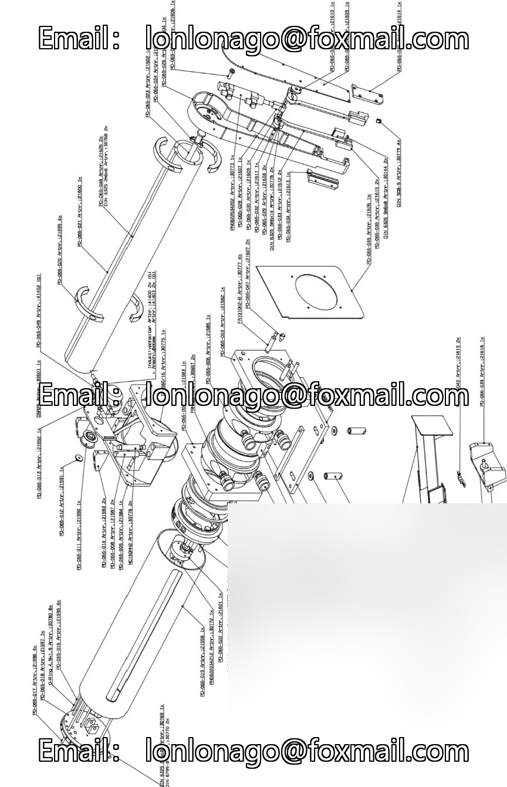
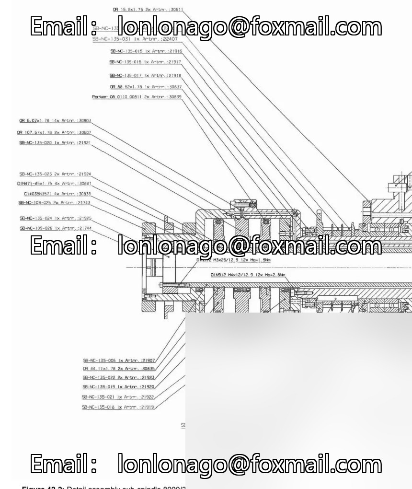
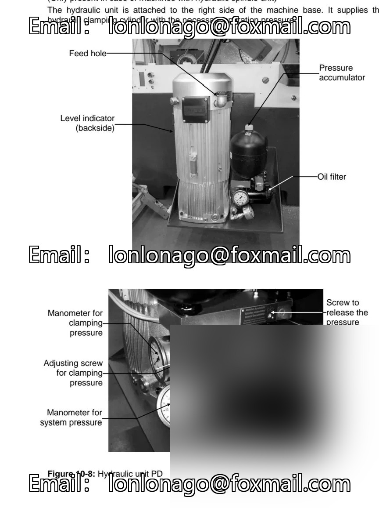
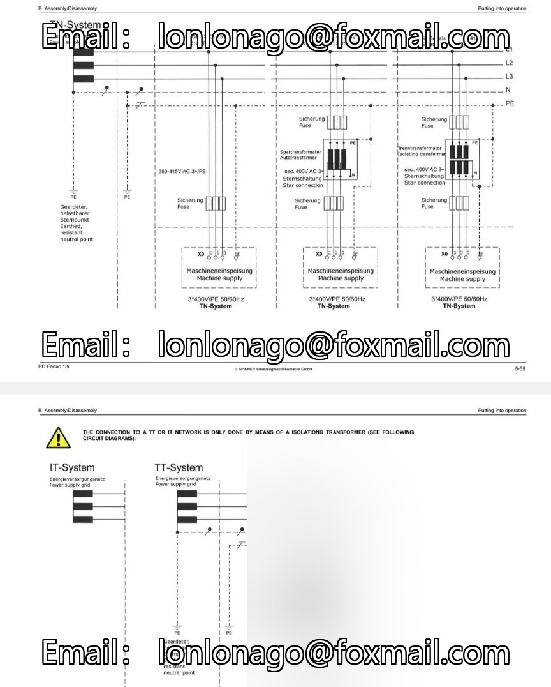
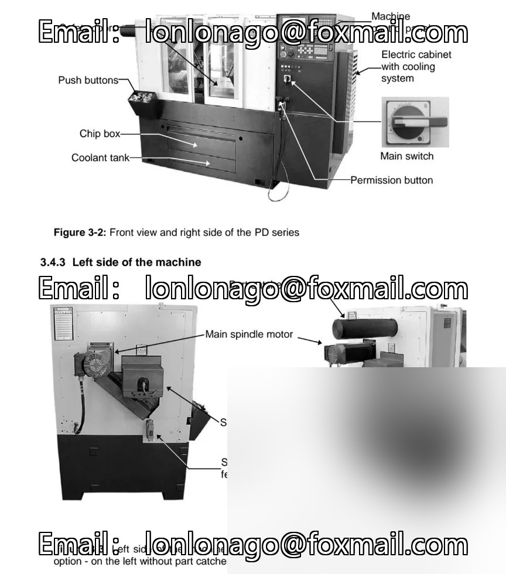

# German Spinner SPINNER PD lathe materials

## Body

German Spinner SPINNER PD lathe materials - German SPINNER (Spinner) Company produces the PD series ultra-precision lathe (Ultra Precision Lathe PD), equipped with FANUC 32i-B CNC system.
Document properties: Technical Product Documentation (Technical Product Documentation), Translation of the original manual (TRANSLATION OF ORIGINAL MANUAL).
PDF electronic file, 470 pages

The PD series is the flagship high-precision equipment of SPINNER, mainly used for micro-scale high-precision machining and hard turning (substituting grinding):
49331
Ultimate precision: can achieve sub-micron-level precision machining, with the workpiece of the spindle usually hardened to 60 HRC, achieving "turning instead of grinding", and obtaining excellent surface smoothness (mirror finish turning).

High rigidity structure: Usually adopts precision sliding rails with high precision and hardened, and ground (with excellent damping performance), matched with ultra-precision spindle bearing.

Flexible configuration: can configure power tools (machining), sub-shaft (double-face processing), Y-axis, automatic feed-up-feed mechanical hands or bar material conveyors, adapting for small-batch precision parts to large-batch automated production.

PD series is the flagship high-precision equipment of SPINNER, mainly used for micrometer-level high-precision machining and hard turning (replacing grinding):

Ultimate precision: can achieve sub-micron-level fine machining, with main spindles and workpieces hardened to a uniformity of 60 HRC, achieving "car replacing grinding," and obtaining excellent surface smoothness (mirror surface grinding).

High rigidity structure: Usually adopts precision sliding rails with high precision and hardened, and ground (with excellent damping performance), matched with ultra-precision spindle bearing.

Flexible configuration: can configure power tools (machining), sub-shaft (double-face processing), Y-axis, automatic feed-up-feed mechanical hands or bar material conveyors, adapting for small-batch precision parts to large-batch automated production.

The German SPINNER PD ultra-precision lathe material consists of a technical product documentation, a translation of the original manual, and a PDF of 470 pages.

<!-- AI_ENRICHED -->

## Images

## Payment

Here is a pay link on Stripe ( https://buy.stripe.com/3cs8yP7sY87d0vu9AB ). Please contact me lonlonago@foxmail.com after funding $89, and I will send you a complete data files , thank you!

